# UR PathGen SF1: Collision-Free Path Generation for a UR10e Collaborative Robot in the JIC Smart Factory Flexible Cell

Path generation and optimisation for a UR10e collaborative robot within the JIC Smart Factory
workspace for flexible small-batch production with high process variability.


<p align="center">
<picture>
  <source media="(prefers-color-scheme: dark)" srcset="Media/cell_overview_dark.png">
  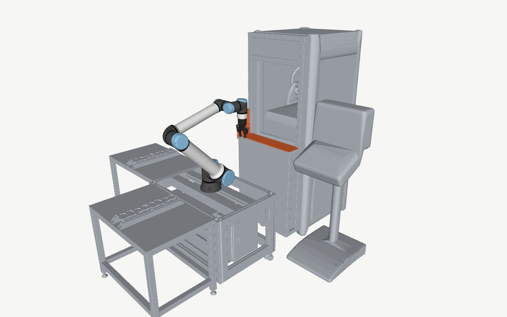
</picture>
</p>

**Figure 1:** The SF1 cell as the planner models it: the UR10e with the Robotiq 2F-85 on its stand,
machine (a), the tables, the side cabinet and, in orange, the regrasp station. The environment is
the collision model with its configured corrections, not the original CAD.

> [!WARNING]
> **Simulation passed ≠ safe on the robot.** Every path in this repository is verified in a
> simulation model; only c2 has been tested on the real cell (owner, 2026-10-21). Run any other
> path on the real cell at reduced speed first.

## Contents

[About](#about) · [Results](#results) · [Quick start](#quick-start) · [How it works](#how-it-works) ·
[Inputs and outputs](#inputs-and-outputs) · [Limitations and safety](#limitations-and-safety) ·
[Repository layout](#repository-layout) · [License](#license) · [Acknowledgement](#acknowledgement)

## About

Developed within internal research at JIC Smart Factory for **SF1 (Smart Factory 1)**, a flexible
machine-tending cell ("SF1" in file names refers to it): a Universal Robots UR10e with a Robotiq
2F-85 gripper loads a machine and turns the part over in a regrasp station. The cell operator taught
the regrasp by hand on the teach pendant (case 17 of the robot program). Its station operations are
tight, but the transfer motions between them take most of the cycle (an estimated 21.06 of 23.37 s).

- A **MuJoCo digital twin** of the cell: the UR10e and 2F-85 models corrected to the official UR10e
  DH parameters, in a validated collision model of the cell's CAD.
- A **joint-space planner** that re-plans only the three transfer segments, keeps every taught
  station operation line for line, and minimises the estimated duration under explicit margins.
- Several **strategies compared** on the same model: the taught program, the optimised transfers,
  another wrist-3 representative at the re-grip, and other IK branches at the drop.

## Results

Case 17, home → home. All values are **simulation estimates**; every metric is in
[`comparison.md`](Data/Generated/variants/comparison.md).

| Variant | Status | Est. home → home [s] | vs taught | Max robot height [m] |
|---|---|---:|---:|---:|
| `taught` | the taught program (reference) | 23.37 | — | 2.322 |
| `b_optimised` | previous optimisation, superseded by c1 | 17.50 | −25.1 % | 2.263 |
| `c1` | previous optimisation (simulation only) | 14.66 | −37.3 % | 2.263 |
| `c2` | **delivered — tested on the real cell (owner, 2026-10-21)** | 12.05 | −48.4 % | 1.818 |
| `c3` | proposal for re-teaching, not verified on the robot | 13.86 | −40.7 % | 1.780 |

<picture>
  <source media="(prefers-color-scheme: dark)" srcset="Media/cycle_time_dark.png">
  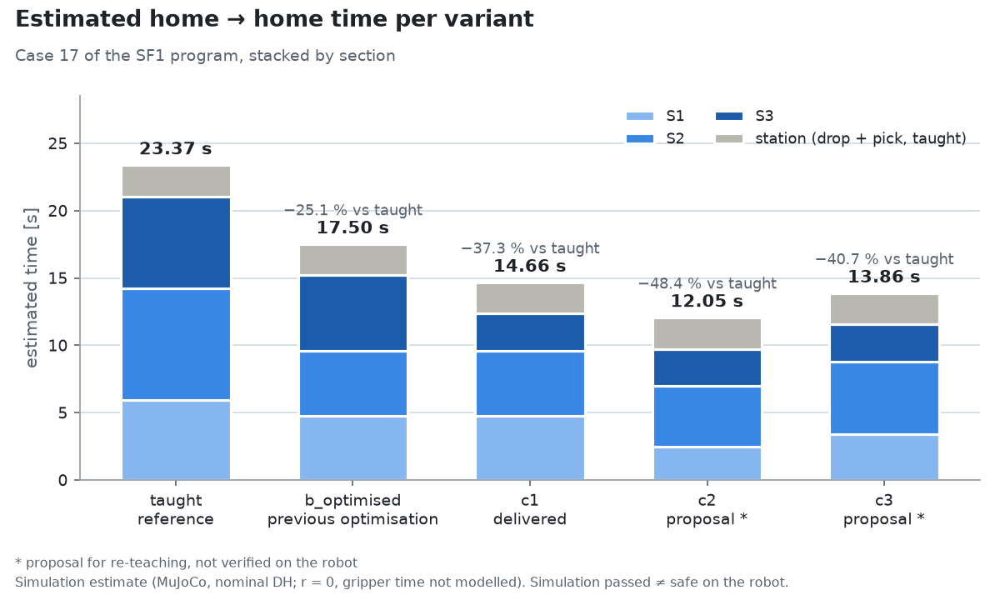
</picture>

**Figure 2:** Estimated home → home time per variant, stacked by section, with the total and its change against
the taught program. An estimate: every move from rest to rest (r = 0); blends and gripper time are
not modelled.

<picture>
  <source media="(prefers-color-scheme: dark)" srcset="Media/path_c2_dark.png">
  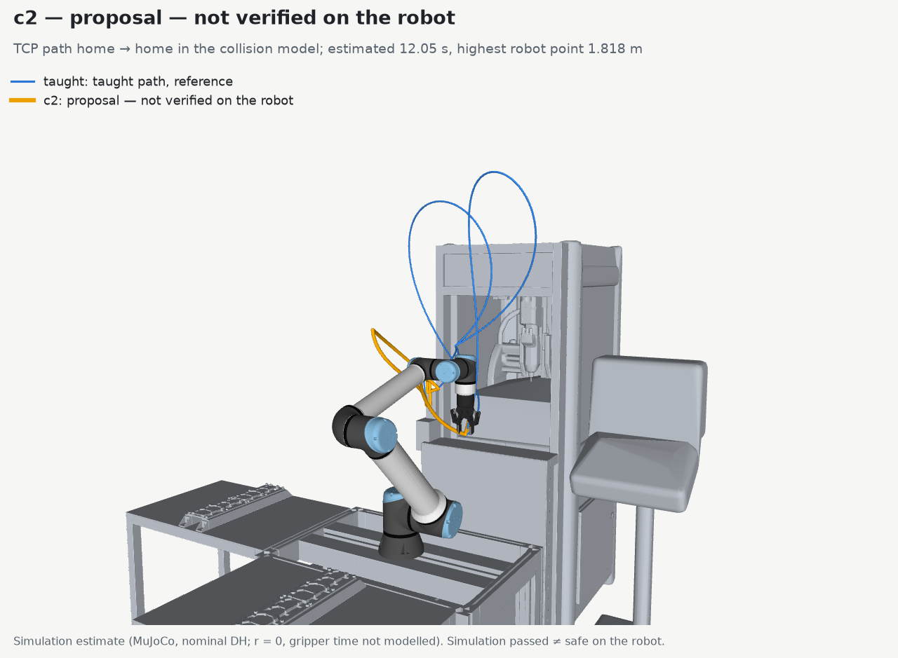
</picture>

**Figure 3:** c2 (amber), delivered — tested on the real cell (owner, 2026-10-21): the drop on IK
branch S− E− W−, so the transfers stay low. Estimated 12.05 s; highest robot point 1.818 m. The
taught path is drawn thin in blue for reference.

<details>
<summary><b>All metrics</b>: the full comparison table and its notes</summary>

Case 17 of the program, home → home. All values are **simulation estimates** from
[`Data/Generated/variants/comparison.csv`](Data/Generated/variants/comparison.csv), written by
`Example/write_variants.py`. The estimated time assumes every move goes from rest to rest (r = 0);
the program's blends and the gripper time are not modelled.

| Variant | Status | Est. home → home [s] | vs taught | Via points | Joint travel Σ\|Δq\| [rad] | TCP path [m] | Max robot height [m] | Closest, S1–S3 [mm] | Least room above margin, S1–S3 [mm] |
|---|---|---:|---:|---:|---:|---:|---:|---:|---:|
| `taught` | the taught program (reference) | 23.37 | — | 5 | 45.440 | 7.062 | 2.322 | 8.4 | 3.4 (margin 5) |
| `b_optimised` | previous optimisation, superseded by c1 | 17.50 | −25.1 % | 4 | 38.642 | 6.604 | 2.263 | 10.1 | 0.4 (margin 30) |
| `c1` | previous optimisation (simulation only) | 14.66 | −37.3 % | 4 | 35.395 | 6.446 | 2.263 | 10.1 | 0.4 (margin 30) |
| `c2` | **delivered — tested on the real cell (owner, 2026-10-21)** | 12.05 | −48.4 % | 2 | 23.462 | 3.237 | 1.818 | 10.1 | 5.1 (margin 5) |
| `c3` | proposal for re-teaching, not verified on the robot | 13.86 | −40.7 % | 4 | 24.792 | 3.372 | 1.780 | 10.1 | 5.1 (margin 5) |

- **The variants.** `b_optimised` re-plans S1–S3 on the taught points. `c1` (previous optimisation
  (simulation only), also in `Data/Generated/`) does the same with the re-grip's wrist 3 one turn
  lower (the same poses), so S3 no longer turns wrist 3 by a full extra turn. `c2` and `c3` put the
  drop on another IK branch of the same taught poses (S− E− W− and S− E− W+); with these drop points
  the planned transfers stay low (highest robot point 1.818 and 1.780 m instead of 2.263 m). Their
  drop points are nominal-DH solutions. `c2` was delivered and tested on the real cell (owner,
  2026-10-21); `c3` must be re-taught and verified on the robot.
- **Clearance.** Closest is the smallest robot–environment distance in the three transfer segments.
  Least room is that distance minus the margin of the pair concerned: taught segments are judged by
  the taught rule, generated ones by the generated rule (20 mm to the environment, 30 mm to
  machine (a) outside the station zone, 5 mm inside the station zone). No variant has a sample that
  breaks its rule.
- **The station operations** (drop and re-grip) are the taught lines in every variant. Their
  closest pair, 5.5 mm between the gripper and the station bracket at the re-grip, is the same in
  all five and is the smallest distance of the whole cycle.

</details>

<details>
<summary><b>All figures</b>: the cell, the collision model, every path and the other graphs (Figures 4–15)</summary>

Every image is generated from the repository data by
[`Example/make_readme_figures.py`](Example/make_readme_figures.py); none is drawn by hand. All of
them show simulation estimates. Every render shows the environment as the collision model the
planner checks against: the convex decomposition of the cell's CAD with the configured corrections,
not the original CAD.

<table>
  <tr>
    <td><picture>
  <source media="(prefers-color-scheme: dark)" srcset="Media/robot_home_dark.png">
  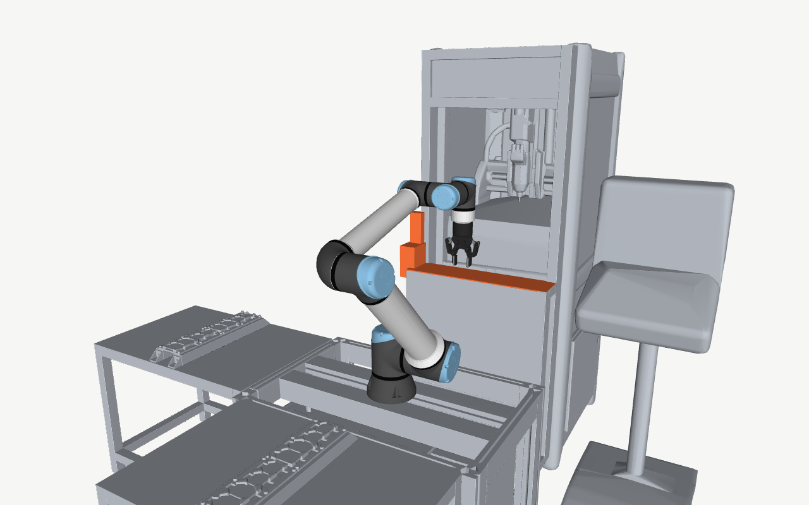
</picture>
<p><b>Figure 4:</b> The robot at home, shown by its visual meshes, in front of machine (a). The station-zone pieces are orange.</p></td>
    <td><picture>
  <source media="(prefers-color-scheme: dark)" srcset="Media/station_collision_dark.png">
  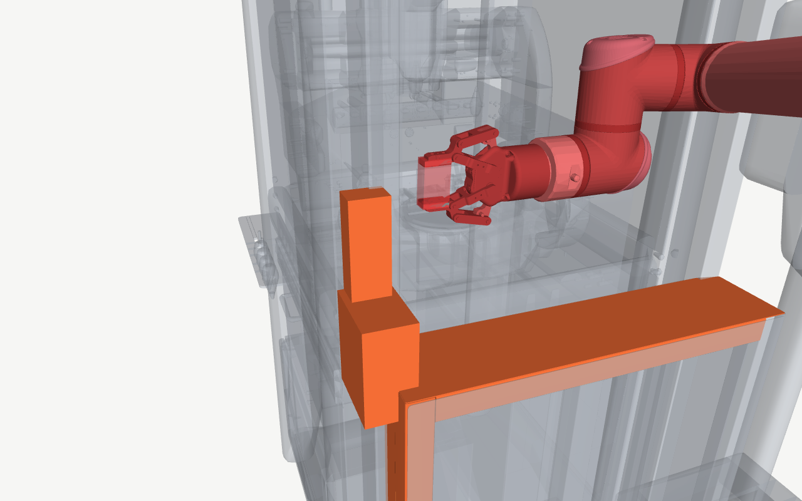
</picture>
<p><b>Figure 5:</b> The regrasp station close up, the robot at <code>Waypoint_5</code> (the retreat after the drop). Machine (a) is translucent so that the station-zone pieces (orange) and the robot's and gripper's collision hulls (red) show.</p></td>
  </tr>
</table>

<picture>
  <source media="(prefers-color-scheme: dark)" srcset="Media/collision_model_dark.png">
  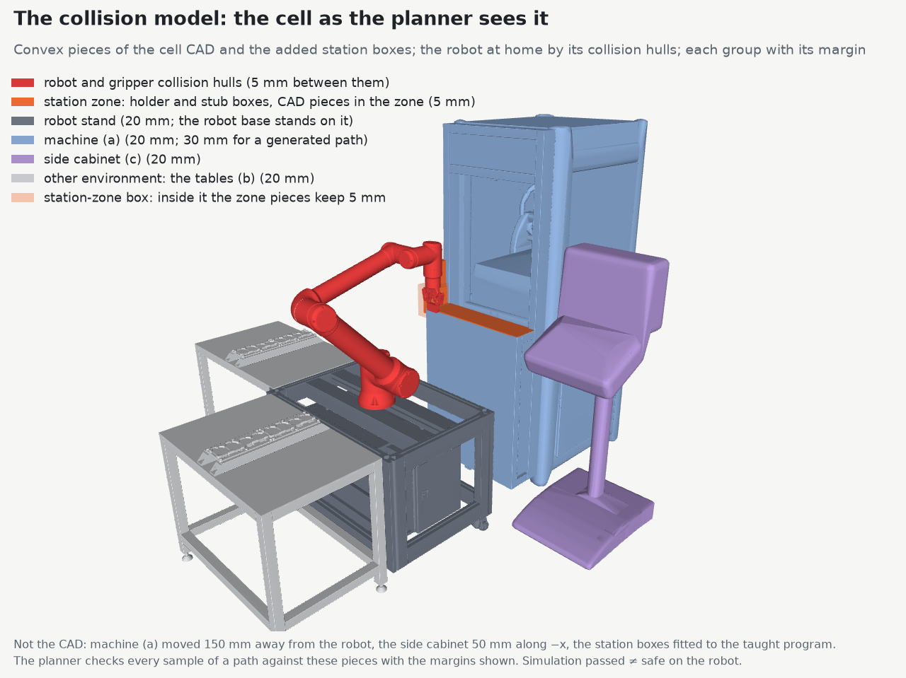
</picture>

**Figure 6:** Everything the planner checks a path against, each group in its colour with the margin it keeps
(legend). Machine (a) and the side cabinet are at their corrected positions, the station holder and
stub are boxes fitted to the taught program, and inside the small translucent station-zone box the
zone pieces keep 5 mm instead of 20 mm (see [How it works](#how-it-works)).

The path renders show one variant's TCP path, home → home, in its graph colour, with the taught
path thin in blue for reference. The station-zone pieces are grey there, so that no path is
confused with them. The times and heights in the captions are simulation estimates.

<table>
  <tr>
    <td><picture>
  <source media="(prefers-color-scheme: dark)" srcset="Media/path_taught_dark.png">
  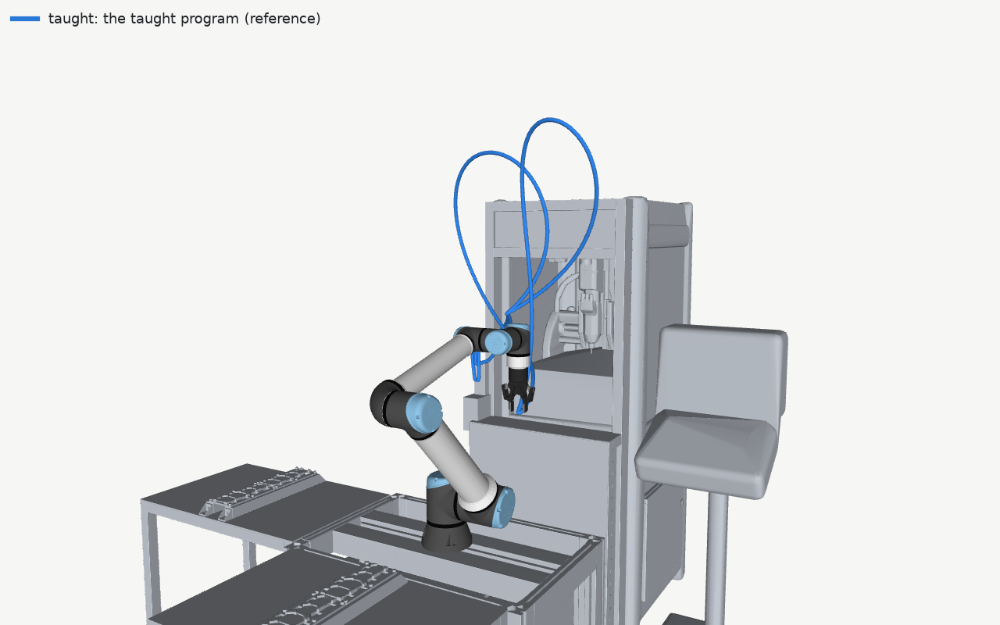
</picture>
<p><b>Figure 7:</b> The taught program, case 17 home → home: the reference for the other path renders. Estimated 23.37 s; the robot reaches 2.322 m.</p></td>
    <td><picture>
  <source media="(prefers-color-scheme: dark)" srcset="Media/path_b_optimised_dark.png">
  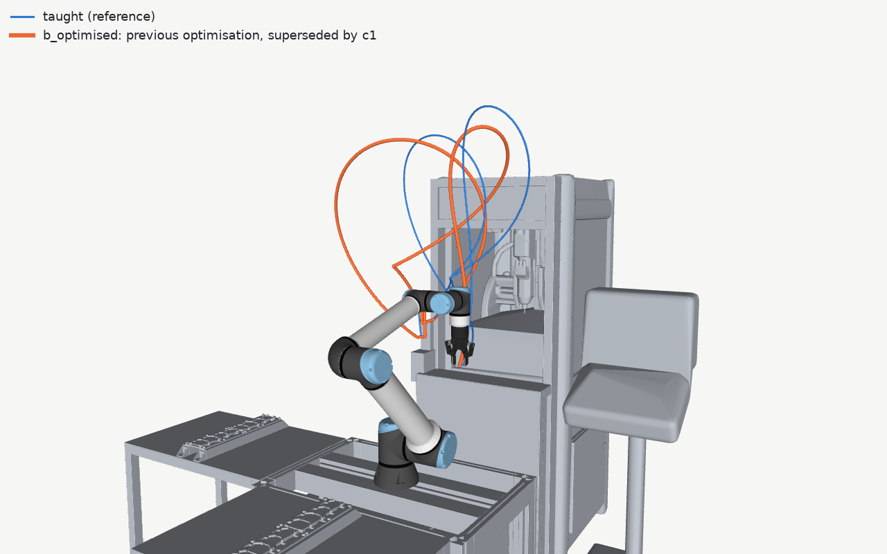
</picture>
<p><b>Figure 8:</b> b_optimised (orange): S1–S3 re-planned on the taught points. Estimated 17.50 s; highest robot point 2.263 m.</p></td>
  </tr>
  <tr>
    <td><picture>
  <source media="(prefers-color-scheme: dark)" srcset="Media/path_c1_dark.png">
  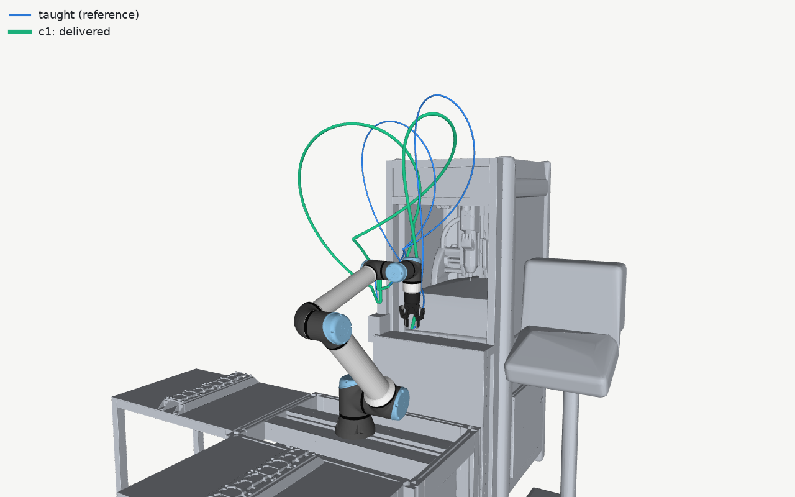
</picture>
<p><b>Figure 9:</b> c1 (green), previous optimisation (simulation only): as b_optimised, with the re-grip's wrist 3 one turn lower. Estimated 14.66 s; highest robot point 2.263 m.</p></td>
    <td><picture>
  <source media="(prefers-color-scheme: dark)" srcset="Media/path_c3_dark.png">
  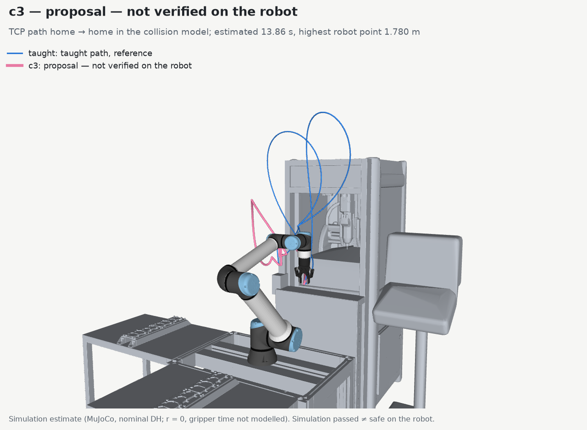
</picture>
<p><b>Figure 10:</b> c3 (pink), proposal, not verified on the robot: the drop on home's IK branch S− E− W+. Estimated 13.86 s; highest robot point 1.780 m.</p></td>
  </tr>
</table>

<picture>
  <source media="(prefers-color-scheme: dark)" srcset="Media/path_length_dark.png">
  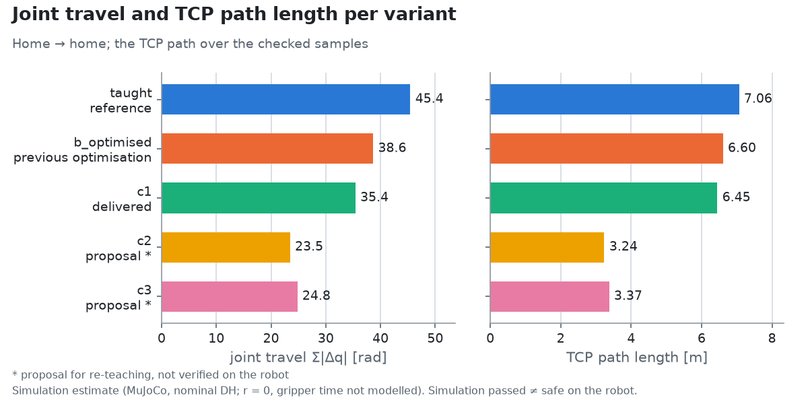
</picture>

**Figure 11:** Joint travel (the sum of |Δq| over the six joints) and TCP path length per variant, home → home,
computed in simulation. Less motion does not by itself mean less time.

<picture>
  <source media="(prefers-color-scheme: dark)" srcset="Media/max_height_dark.png">
  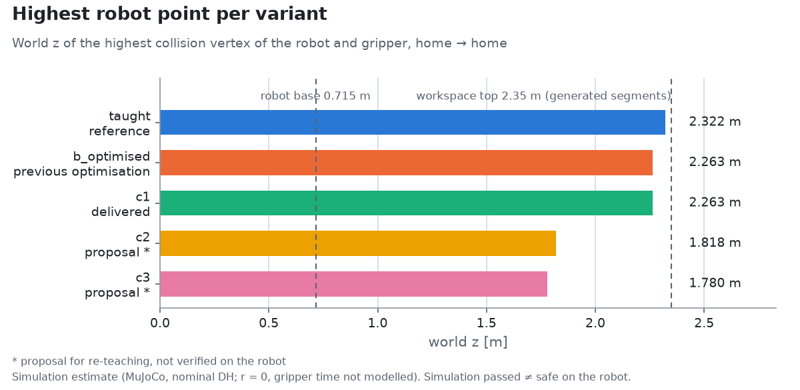
</picture>

**Figure 12:** The highest point of the robot and gripper (world z) per variant, computed in simulation, against
the robot base and the workspace top that generated segments must stay below.

<picture>
  <source media="(prefers-color-scheme: dark)" srcset="Media/clearance_dark.png">
  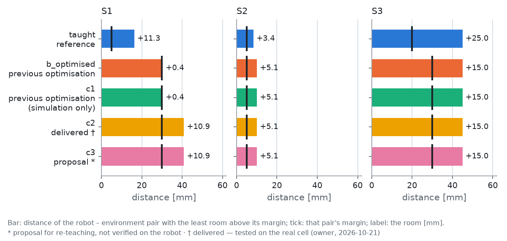
</picture>

**Figure 13:** Per transfer segment, the robot–environment pair with the least room above its margin: bar the
distance, tick the margin, label the room. Taught segments are judged by the taught rule, generated
ones by the generated rule (20 mm to the environment, 30 mm to machine (a) outside the station
zone, 5 mm inside it); simulation values.

<picture>
  <source media="(prefers-color-scheme: dark)" srcset="Media/joints_dark.png">
  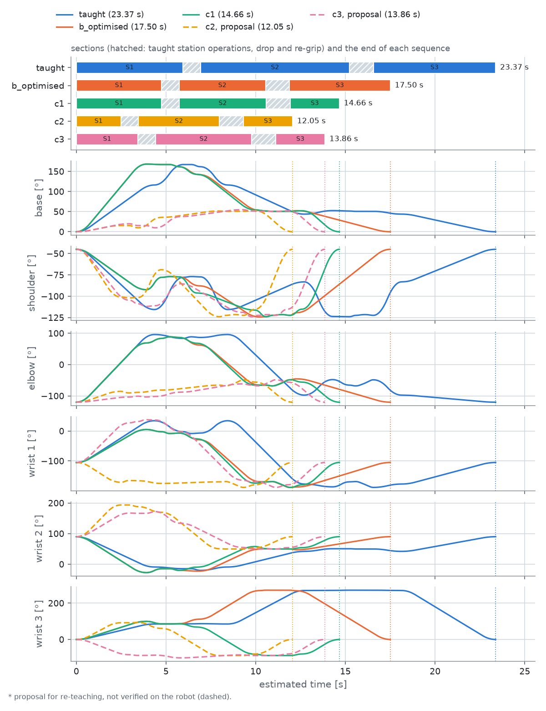
</picture>

**Figure 14:** The six joint angles of all five variants over the estimated time, under a timeline of each
variant's sections (taught station operations hatched); a dotted line marks where each sequence
ends, and the proposal c3 is dashed. The timing is an estimate: every move from rest to
rest (r = 0), blends and gripper time not modelled.

<picture>
  <source media="(prefers-color-scheme: dark)" srcset="Media/tcp_paths_dark.png">
  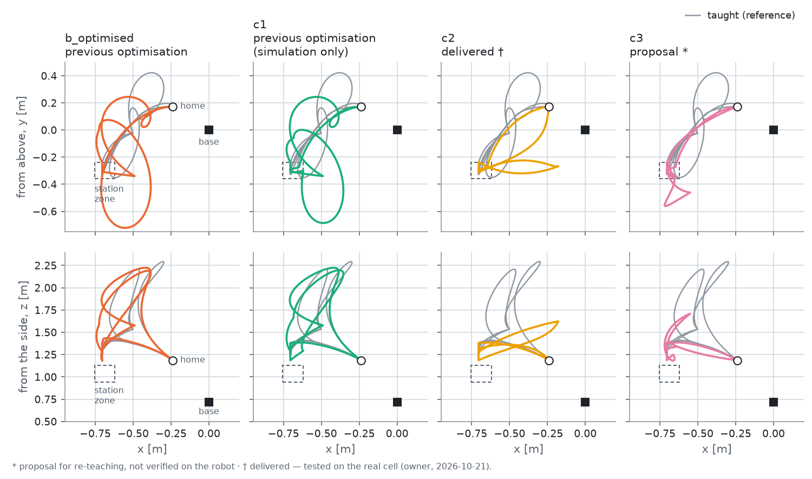
</picture>

**Figure 15:** TCP paths home → home from above (top row) and from the side (bottom row), each variant in its
colour against the taught path in grey, with the robot base, home and the station zone; computed in
simulation.

</details>

## Quick start

**Install.** macOS on Apple silicon (verified) or Ubuntu Linux (not verified), with Python 3.11:

```bash
brew install python@3.11                          # macOS
sudo apt install python3.11 python3.11-venv       # Ubuntu
./install.sh
```

`install.sh` creates `.venv`, installs the pinned `requirements.txt`, and verifies the vendored
models against their recorded hashes and the cell STL against the hash the collision set was built
from.

**Run.** View a learned position with its clearance, replay a variant (case 17, home → home), and
run the optimisation, which plans S1–S3 of case 17 and writes c2, the delivered path, to
`Data/Generated/`. The viewer needs
`mjpython` on macOS; on Linux use `.venv/bin/python`.

```bash
.venv/bin/mjpython Example/demo_visualize_position.py --pos home_q   # view a learned position
.venv/bin/mjpython Example/replay_rotation.py --path 4               # replay c2, the delivered path (--path below)
.venv/bin/python Example/plan_rotation.py --workers 8                # about 3 minutes on an M2 Pro
```

| `--path` | Path (case 17, home → home) |
|---|---|
| 1 | taught |
| 2 | b_optimised: previous optimisation |
| 3 | c1: previous optimisation (simulation only) |
| 4 | c2: delivered — tested on the real cell (owner, 2026-10-21) |
| 5 | c3: proposal, not verified on the robot |
| 6 | all five in turn, with the strict comparison |

**Plan another case.** What is planned is a job, `Configuration/Jobs/<name>.yaml`: the program
folder, the case, the segments to optimise and the output names. Cut the case out of the program
export, write a job (copy `sf1_plc_v4_case_17.yaml`), plan it and replay it:

```bash
.venv/bin/python Example/extract_program.py --program PATH/sf1_plc_v4.script --cases 17 18 --out Data/Programs/sf1_plc_v4/
.venv/bin/python Example/plan_rotation.py --job <name> --workers 8 --out /tmp/<name>
.venv/bin/mjpython Example/replay_rotation.py --job <name> --out /tmp/<name>
```

The case also needs a `Tool.Holding_Openings` entry (program, case, opening) in
`Configuration/Cell_SF1.yaml`. Before planning, the case's taught moves are checked against the
model; a taught move inside it stops the run (the whole procedure: **Another program, case or
path** under [Inputs and outputs](#inputs-and-outputs)). `sf1_plc_v4_case_18.yaml` is an example
job: it plans once the case-18 opening is configured.

<details>
<summary><b>All usage</b>: options, comparing runs, regenerating the variants, figures and inputs, the tests</summary>

**Installation.** `install.sh` is safe to re-run; `./install.sh --detect-only` only reports what it
would do. Scripts that only compute or write files run with `.venv/bin/python` on both systems.

**Show the robot at a learned position**, with its clearance:

```bash
.venv/bin/mjpython Example/demo_visualize_position.py --pos home_q
.venv/bin/python Example/demo_visualize_position.py --list
```

Viewer geom groups (number keys): `1` the cell STL, `2` the robot's visual meshes, `3` the collision
geometry. `--with-stl` also loads the cell STL, which the viewers leave out by default. The STL is
the original CAD without the collision model's corrections, so it does not match the geometry the
clearance is checked against; the viewers print a warning naming the corrections.

**Replay the variants** in the viewer, or write screenshots or a step list instead:

```bash
.venv/bin/mjpython Example/replay_rotation.py --path 4
.venv/bin/mjpython Example/replay_rotation.py --path 6 --speed 2
.venv/bin/python Example/replay_rotation.py --path 4 --screenshots /tmp/sf1_c2
.venv/bin/python Example/replay_rotation.py --path 4 --headless
```

`--list` prints the catalogue, `--skip-check` replays without the clearance check (labelled so), and
`--with-stl` loads the cell STL.

**Run the optimisation.** One command plans S1–S3 of case 17 and writes its output, c2 (the
default job, `Configuration/Jobs/sf1_plc_v4_case_17.yaml`):

```bash
.venv/bin/python Example/plan_rotation.py --workers 8
```

- **Reads:** the job (`--job NAME`, default `sf1_plc_v4_case_17`), its program's two extracts,
  `Configuration/Cell_SF1.yaml`, the collision set and the models.
- **Writes:** `Data/Generated/SF1_Rotation_17.urscript` and `SF1_Rotation_17_Sequence.script`,
  only after every segment has passed the final check. On any error it writes nothing and exits
  with 1.
- **Prints:** the check of the learned points, the margins, the check of the case's taught moves
  against the model, and per segment the taught and the
  optimised path (via points, estimated time, joint travel, closest distance, rule violations),
  with the home → home totals.
- **Options:** `--job NAME` plans another job (`Configuration/Jobs/NAME.yaml`, or a `.yaml` path),
  `--out DIR` writes elsewhere, `--workers N` sets the planning processes (the output
  does not depend on N), `--penalty-weight W` sets the clearance weight (default 0.5 s/m),
  `--config FILE` sets the configuration.
- **Time** (M2 Pro, 2026-10-21): about 3 minutes with 8 workers (2 min 43 s), about 10.5 minutes
  with 1 (10 min 27 s).

**Compare and replay a result.** The committed output is the reference. Write a new run elsewhere
and compare it with `diff`; an unchanged input gives identical files:

```bash
.venv/bin/python Example/plan_rotation.py --workers 8 --out /tmp/sf1_plan
diff /tmp/sf1_plan/SF1_Rotation_17.urscript Data/Generated/SF1_Rotation_17.urscript
diff /tmp/sf1_plan/SF1_Rotation_17_Sequence.script Data/Generated/SF1_Rotation_17_Sequence.script
```

The replay plays the variant folders in `Data/Generated/variants/` (`--path 4` is c2, the delivered path and
the output of `plan_rotation.py`; `--path 3` is c1, the previous optimisation). A run written elsewhere
is replayed with `--job NAME --out DIR` (above). To tabulate a new plan, regenerate the variants. This re-plans b_optimised, c1, c2 and c3 into
`Data/Generated/variants/`, overwriting the committed files (`git diff` shows what changed), and
rewrites the comparison table. Then rewrite the figures:

```bash
.venv/bin/python Example/write_variants.py --workers 8        # about 6 minutes; --table-only re-measures
.venv/bin/python Example/make_readme_figures.py               # under a minute; --graphs-only skips the renders
```

**Rebuild the inputs** after the robot program or the cell STL changes:

```bash
.venv/bin/python Example/write_taught_programs.py             # the simplified taught case 17
.venv/bin/python Example/build_collision.py                   # about 19 minutes, runs CoACD
```

**Run the tests.** The everyday command leaves out the seven slow tests and takes about 9 minutes;
run the full suite (about 20 minutes) before a commit:

```bash
.venv/bin/python -m pytest -m "not slow"
.venv/bin/python -m pytest
```

Measured on an M2 Pro, 2026-10-23 (one run each: 9 min 12 s and 19 min 53 s). The slow tests are
the parallel planning run (211 s), the variant table re-measured from the files (67 s), the replay of
every program segment (62 s), the README graphs regenerated byte for byte (4 s), each case-17 job
(c2, c1) reproducing its committed variant, and case 18 planning without code changes; the four
times were measured 2026-10-20, before the last three tests existed.

</details>

## How it works

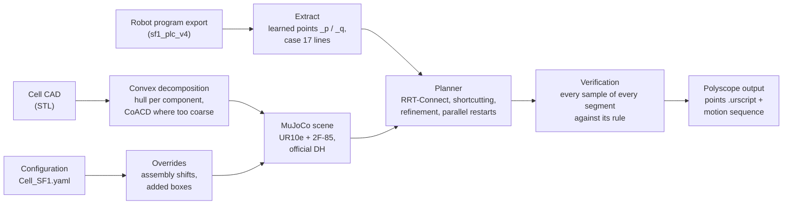

- **Planner.** Only the transfer segments S1–S3 are planned, in joint space: the direct segment if
  it is clear, otherwise RRT-Connect with 20 seeded restarts, shortcutting and local refinement, in
  parallel processes. The objective is the estimated UR `movej` time plus a clearance penalty.
- **Collision model and rules.** The cell CAD becomes convex pieces that contain its surface, with
  configured corrections. Generated segments keep 20 mm to the environment, 30 mm to machine (a)
  and 5 mm inside the station zone only near the taught station points; taught lines keep the
  taught rule.
- **Kinematics.** The official UR10e DH parameters, with the MuJoCo model patched to match them, the
  configured TCP and an analytic IK with up to 8 branches. Every learned point is checked at load.
- **Verification.** Every sample of every generated segment is checked again before anything is
  written; at most five via points per segment, or an explicit failure.
- **Determinism.** Iteration budgets and a recorded seed: the same inputs give byte-identical
  output for any number of worker processes.

<details>
<summary><b>The full method</b>: planning steps and parameters, collision checking, kinematics, determinism</summary>

**Planning.** Only the three transfer segments of case 17 are planned: S1 home → `drop_rotate_1`, S2
`Waypoint_5` → `Waypoint_18` (gripper open) and S3 `Waypoint_6` → home. Every station line stays as
taught. Each segment is planned in joint space between the `_q` of its ends, which are never
wrapped:

1. Both ends must keep the generated rule (below); otherwise the run stops with an error naming
   the pairs.
2. **The direct segment** is taken if it keeps the rule.
3. Otherwise, **RRT-Connect** runs 20 times (restarts), each with its own seed. It works within the
   joint limits, with a step of 0.35 rad and at most 3000 extensions. Half of its samples are drawn
   from the box around both ends widened by 1 rad, half from the whole range. Each path found is
   **shortcut** 150 times.
4. The two fastest paths are **refined locally** (150 attempts each): a via point is removed or
   moved by a random step that shrinks from 0.20 to 0.01 rad. A change is kept only if it lowers the
   cost and both touched segments keep the rule.
5. The lowest cost wins; ties go to fewer via points. More than five via points, or no path, is a
   failure and nothing is written.
6. The chosen path is checked again, every sample of every segment, with no shortcut in the check.

**The objective** is the estimated duration plus 0.5 s/m × a clearance penalty. The duration is the
UR `movej` estimate: the trapezoidal profile of the leading joint from rest to rest, with the
program's a = 1.396 rad/s² and v = 1.047 rad/s and r = 0. The penalty is the sum over the samples of
max(0, 30 mm − d), where d is the robot–environment distance. It counts outside the 50 mm station
neighbourhood only. The penalty prefers clearance above the margins; it never replaces them.

**Parallel restarts.** With `--workers N`, the restarts and refinements of all three segments run
in N processes, each with its own copy of the scene. The result is the same for every N.

**Collision checking.**

- **The environment** is the cell STL, cropped to what the robot can reach. Each connected
  component becomes its convex hull. Where a hull exceeds the original surface by more than 10 mm,
  the component is split by CoACD into convex parts, which must contain the original surface within
  1 mm; otherwise the hull is kept. Flat components are thickened by 0.5 mm. That gives 6718 pieces.
  One open shell, the interior of machine (a), stays a filled hull, so the model is not valid inside
  the machine. The corrections from the configuration move whole objects (machine (a), the side
  cabinet) and add boxes (the station holder and stub). See Figure 6 under
  [All figures](#results).
- **The robot and gripper** are their collision hulls, with the gripper rigid at its opening: 50 mm
  while holding the part, 85 mm open. Self-collision exclusions are listed explicitly.
- **Margins.** The robot keeps 20 mm to the environment and 5 mm to itself (MuJoCo contacts,
  filtered per pair). A segment is sampled joint-linearly, as `movej` moves, so densely that no
  robot point moves more than 5 mm between two samples.
- **Taught vs generated rule.** Program lines are judged by the taught rule, under which the
  station-zone pieces need 5 mm and everything else 20 mm. Generated segments are judged by the
  stricter generated rule:
  - 20 mm everywhere. The 5 mm zone margin applies only while the TCP is within 50 mm of a fixed
    station point.
  - 30 mm to machine (a) outside the zone (its position is estimated to ±10 mm).
  - No closer to a station box than the closer of the segment's two taught ends.
  - Every robot collision geom inside the workspace box, whose top, 2.35 m, is the highest point
    the taught sequence reaches. Space outside the CAD is not modelled.
- **The station zone** is a configured box around the holder. The holder's geometry is fitted to
  the taught program, not measured, so a generated path may not use it more tightly than the taught
  program does.

**Kinematics.**

- **One kinematic truth: the official UR10e DH parameters.** The vendored MuJoCo Menagerie model
  stays byte-identical. Its body offsets are patched in code when the scene is built, so that
  MuJoCo's forward kinematics equals the DH forward kinematics.
- **The TCP is configured, not derived:** (0, 0, 174) mm, the robot's TCP setting.
- **Analytic IK** returns up to 8 solutions of a pose, each labelled by its branch S± E± W± and
  checked by forward kinematics. It produces the c2 and c3 drop points (nominal DH, so they must be
  re-taught).
- **Every learned point is checked at load:** DH FK · TCP against its `_p`, within 10 mm (half the
  environment margin). The largest residual of the 78 points is 4.04 mm / 0.377°. This is the gap
  between nominal DH and the robot's calibrated kinematics; no calibration file is used.

**Determinism.** Every budget is an iteration count, never a time. Segment k of the case plans with
the seed 20261017 × 1000 + 17 × 10 + k, and each restart and refinement derives its own generator
from it. A run therefore depends only on its inputs. Re-planned on 2026-10-21 with 8 workers and
with 1, the output was byte-identical to the committed `Data/Generated/`, and so were the re-planned
variants.

</details>

## Inputs and outputs

The input of the whole project is the robot program `sf1_plc_v4.script`, committed as two verbatim
extracts. **Do not delete the extracts**: every script takes its learned points and program lines
from them, and without them nothing can be planned, replayed or checked.

| File | Role |
|---|---|
| `Data/Programs/sf1_plc_v4/sf1_plc_v4_positions.urscript` | **Input:** the program's 78 learned points (`global <name>_p` / `_q`) |
| `Data/Programs/sf1_plc_v4/sf1_plc_v4_cases_17_18.script` | **Input:** the program lines of cases 17 and 18 |
| `Data/Generated/SF1_Rotation_17.urscript`, `SF1_Rotation_17_Sequence.script` | **Output:** c2, the delivered path, the output of `plan_rotation.py`: its points and its motion sequence |
| `Data/Generated/variants/` | **Output:** every variant in the same two files, the delivered c2 among them, and `comparison.csv` / `comparison.md` |

<details>
<summary><b>Every file</b>, the two file formats and how the extracts were made</summary>

`sf1_plc_v4.script` is the URScript file the controller generates from the Polyscope program. The
program itself is not committed (it holds Robotiq URCap code and network settings); its two
extracts are.

| File | What it is | Read by |
|---|---|---|
| `Data/Programs/sf1_plc_v4/sf1_plc_v4_positions.urscript` | **Input.** The program's 78 learned points as `global <name>_p` / `_q` lines (program lines 2453–2608) | every script but `build_collision.py` and `extract_program.py` (which writes it) |
| `Data/Programs/sf1_plc_v4/sf1_plc_v4_cases_17_18.script` | **Input.** The program lines of cases 17 and 18 (lines 3397–3478 and 3480–3561), with their indentation, Polyscope markers and URCap code | every script that loads a job: `plan_rotation.py`, `replay_rotation.py`, `write_variants.py`, `write_taught_programs.py`, `make_readme_figures.py`, `demo_visualize_position.py` |
| `Configuration/Jobs/<name>.yaml` | **Input.** A planning job: the program folder, the case, the segments, the point configurations, the output names | `plan_rotation.py --job`, `replay_rotation.py --job`; the default job also by `write_variants.py`, `write_taught_programs.py` and the viewers |
| `Data/Programs/sf1_plc_v4/sf1_plc_v4_case_17.urscript`, `…_case_17_sequence.script` | The taught case 17, home → home, simplified: the points it moves to and its moves. Written by `write_taught_programs.py` | no script: a reference to compare the output with, line by line |
| `Data/Generated/SF1_Rotation_17.urscript` | **Output.** c2 (delivered — tested on the real cell, owner, 2026-10-21): the learned points it moves to, then the generated via points `via_<from>_<to>_<nn>` | written by `plan_rotation.py` |
| `Data/Generated/SF1_Rotation_17_Sequence.script` | **Output.** c2's motion sequence of case 17, home → home | written by `plan_rotation.py` |
| `Data/Generated/variants/<variant>/` | The same two files for each of `taught`, `b_optimised`, `c1`, `c2` (delivered) and `c3` | written by `write_variants.py`; read by `replay_rotation.py` and `make_readme_figures.py` |
| `Data/Generated/variants/comparison.csv`, `comparison.md` | The comparison table of the variants (the [Results](#results)) | written by `write_variants.py`; the CSV read by `make_readme_figures.py` |

The other inputs are `Configuration/Cell_SF1.yaml`, the collision set in `CAD/Collision/` (built from
`CAD/SF1_Environment.stl` by `build_collision.py`) and the vendored robot and gripper models in
`models/`.

**How the extracts were made.** With `Example/extract_program.py`, which cuts them from the
program, verbatim:

```bash
.venv/bin/python Example/extract_program.py --program PATH/sf1_plc_v4.script --cases 17 18 --out Data/Programs/sf1_plc_v4/
```

Each header records the program's line ranges and its sha256. A case is the whole body of its branch
of the program's switch. The script refuses a case the program does not have, a point with only one
of `_p` and `_q`, and a duplicate name. With `SF1_PLC_V4_SCRIPT` set to the program's path, the
tests check the hash, compare every line of the extracts with the program, and re-extract both files
byte for byte; without it, those tests are skipped.

**Two file formats.**

- **`*.urscript`: points.** Only lines of two forms, plus `#` comments:

  ```text
  global <name>_p=p[x, y, z, rx, ry, rz]    # TCP pose: m, rotation vector in rad, Polyscope base frame
  global <name>_q=[j0, j1, j2, j3, j4, j5]  # joints in rad: base, shoulder, elbow, wrist 1, 2, 3
  ```

  The reader is strict: any other line, a `_p` without its `_q` or a duplicate name is an error.
  Learned points are written back from their original number tokens, so a learned point is
  byte-identical to the program's. A generated via point's `_p` is informational (the forward
  kinematics of its `_q`); the robot is driven by `_q`.
- **`*.script`: the motion program.** One move per line in program order, with `#` comments marking
  the sections and the places of the program's Robotiq gripper nodes. Station lines are copied
  verbatim from the program, `movej(get_inverse_kin(<name>_p, qnear=<name>_q), a=…, v=…)` and
  `movel(<name>_p, a=1.2, v=0.25)`. Generated moves are joint targets only,
  `movej(<name>_q, a=1.3962634015954636, v=1.0471975511965976, r=0)`, with the program's `a` and
  `v`. It is not a complete robot program: the gripper nodes, the PLC I/O and the waits stay in the
  robot program, into which the moves and the points file are put.

The case extract (`sf1_plc_v4_cases_17_18.script`) is neither: it is raw program text, and only
the program-excerpt reader reads it. That reader sorts its lines into moves to learned points,
gripper actions and everything else.

</details>

<details>
<summary><b>What a run needs</b>: the job, the configuration, and what is fixed in code</summary>

**Inputs.** The job; its program's two extracts; `Configuration/Cell_SF1.yaml`; the collision set in
`CAD/Collision/`, built with the configuration's current overrides (the scene refuses a set built
with others); and the vendored models, matching their recorded hashes (`install.sh` checks them).

**Configuration.** Every field of `Cell_SF1.yaml` is required, states its unit and source, and is
validated at load. All problems are named at once:

| Section | Fields | Used for |
|---|---|---|
| Environment | `Visual_Mesh`, `Collision_Set`, `Stand_Region`, `Assembly_Overrides`, `Component_Overrides`, `Added_Boxes` | the cell STL for the viewers, the environment pieces, the stand, the corrections, the station boxes |
| Robot | `Model`, `Base_Position`, `Base_Yaw`, `Joint_Position_Limits` | the robot in the cell, the planner's joint range |
| Tool | `Model`, `Coupling`, `Mount_Yaw`, `TCP_Offset`, `Opening`, `Holding_Openings` (an entry per program and case: sf1_plc_v4 case 17) | the gripper geometry, the TCP, the opening of a scene without a case (the demo, the tests), the opening while the part is held |
| Clearance | `Environment`, `Self`, `Self_Pair_Overrides`, `Station_Zone`, `Machine_Extra`, `Workspace` | the taught and generated rules |
| Self_Collision | `Excluded_Pairs`, `Rigid_Groups` | which robot and gripper bodies are never checked against each other |
| Kinematics | `FK_Sanity_Bound` | the check of every learned point at load |

**The job** (`Configuration/Jobs/<name>.yaml`, validated like the configuration):

| Field | Meaning |
|---|---|
| Program | the program folder in `Data/Programs/`, with its two extracts |
| Case | the case of the program's switch |
| Segments | the segments to optimise, each `{Name, From, To}`: learned points the case moves to, in program order |
| Point_Configurations | learned points written with another `_q`: a joint turn (`Joint`, `Turns`) or an IK branch (`Branch`), each with its source; the `_p` stays the program's |
| Output | the two file names, the title and status written into the headers, and a name per station operation |

The shipped jobs: `sf1_plc_v4_case_17` (the default, c2: the drop on branch S− E− W−, the pick's
wrist 3 one turn lower), `sf1_plc_v4_case_17_c1` (c1) and `sf1_plc_v4_case_18` (an example; no
opening is configured for its part).

**Derived from the program, never configured:** each segment's gripper state (from the case's
gripper lines: holding after a close, open after an open), the station operations (every line
between two segments, copied verbatim), the fixed station points of the clearance rule, the taught
via points, and the station time (from those lines' own `a` and `v`).

**Fixed in code:**

- the seed (20261017; segment k of case c plans with 20261017 × 1000 + c × 10 + k) and the penalty
  weight (0.5 s/m, `--penalty-weight`);
- the program's `movej` a and v, written into every generated move; a job whose taught segment
  moves use another a or v is refused;
- the 30 mm penalty distance, the five-via-point limit and the planner's budgets;
- the STL component that fills machine (a)'s interior (component 1638, labelled "model not valid
  here" in the viewers).

**Fitted to this program**, though they are configuration fields: the station-zone box and
endpoint radius, the station boxes (fitted to the taught samples of cases 17 and 18) and the
workspace top (the highest point of the taught case 17).

</details>

<details>
<summary><b>Another program, case or path</b>; another cell; re-validation</summary>

A new program, case or path is a job and, for a new export, new extracts; no code changes. The
steps:

1. **Extract.** `Example/extract_program.py --program PATH --cases N [N ...] --out
   Data/Programs/<name>/` writes `<name>_positions.urscript` (every `global <name>_p` / `_q` line)
   and `<name>_cases_<n>_<m>.script` (each case's whole branch), verbatim, with the program's line
   ranges and sha256. It refuses a case the program does not have, a point with only `_p` or `_q`,
   a duplicate name, and a case another cases file of the folder already holds. For a new export of
   the same program (for example after re-teaching a drop), re-extract into the same folder; the
   tests that compare the extracts with the program record the line ranges and the hash, so update
   them too.
2. **Write the job.** Copy `Configuration/Jobs/sf1_plc_v4_case_17.yaml` and set `Program`, `Case`,
   `Segments` (the ends of each path to optimise, learned points the case moves to; a segment may
   not contain a gripper action), `Point_Configurations` (empty unless a point needs another `_q`)
   and `Output`. Every field states its meaning, unit and source; the loader names every problem at
   once.
3. **Configure the holding opening.** Add `{Program: <name>, Case: N, Opening: <m>, Source: <text>}`
   to `Tool.Holding_Openings` in `Configuration/Cell_SF1.yaml`; without it the job is refused, never
   given a default.
4. **Plan.** `Example/plan_rotation.py --job <job> --out DIR`. Before planning, the case's taught
   moves are replayed against the model. A taught move inside modelled geometry stops the run: the
   error names the program line, the robot body, the piece and the depth. The station zone, the
   station boxes and the workspace top are fitted to cases 17 and 18, so a stop near the station
   means the model does not describe this case there; nothing is refitted automatically. Less room
   than the taught margin, or a reach above the workspace top, is a warning.
5. **Replay** with `Example/replay_rotation.py --job <job> --out DIR`, then re-validate (below) and
   run the path on the real robot at reduced speed.

Refused before planning, each with a sentence naming the segment and the program line: a segment
end that is not a learned point or not reached in program order, a segment crossing a gripper
action, a station line blending into a generated segment, a configured point the output does not
move to, and taught segment moves at another `movej` a or v than SF1's.

**Another cell**, in this order:

1. **Cell geometry.** Put the cell's STL into `CAD/` (in the world frame the configuration uses)
   and run `Example/build_collision.py`. Read its report: pieces with a large excess (an open shell
   filled by its hull) need a component override or a configured box. Update the component id of
   the machine interior in `Example/plan_rotation.py` (code, not a job field).
2. **Configuration:** every field of `Configuration/Cell_SF1.yaml` (above), each with its source.
3. **TCP.** `Tool.TCP_Offset` is copied from the robot's TCP setting, never derived from the points.
4. Then the program, as above.

**Re-validate before trusting any output:**

- every learned point's DH FK · TCP against its `_p` (the scripts refuse a point outside the
  configured bound);
- the base yaw, by where the taught points land in the cell;
- the collision set's conservativeness and excess;
- the taught program replayed against the model, with every penetration explained;
- the margins against the new kinematic error;
- the planned path on the real robot at reduced speed.

The test suite pins SF1's measured values (residuals, distances, durations). For new inputs they
are measured again, not copied.

**Limits of the current procedure.**

- One job per run.
- The generated moves use SF1's `movej` a = 1.396 rad/s² (80 °/s²) and v = 1.047 rad/s (60 °/s),
  fixed in code. A job whose taught segment moves use another a or v is refused: choose other
  segments, or re-teach them at that speed.
- The variants, the replay catalogue and the README figures are written for case 17.

</details>

## Limitations and safety

- **Simulation passed ≠ safe on the robot.** Every output except the delivered c2 is a proposal
  that has not run on the robot; run it on the real cell at reduced speed first.
- **Nominal DH, no calibration.** The kinematic error, DH FK · TCP against the robot's `_p`, is
  measured at all 78 learned points (at most 4.04 mm / 0.377°), and every learned point is checked
  at load. At the generated via points it is unmeasured.
- **Estimated geometry.** The positions of machine (a) and the side cabinet are estimates, the
  regrasp station is fitted to the taught program, and the model is not valid inside machine (a).
- **Not modelled.** The program's blends, the gripper time, the carried part beyond the pad ends and
  the cables.
- **c2** was delivered and tested on the real cell (owner, 2026-10-21). **c1** (simulation only)
  turns the re-grip's wrist 3 one turn lower than taught; the robot's IK choice at those lines is
  confirmed only by the first run. **c3** is a proposal for re-teaching, never run.
- The joint limits are the hardware range; the cell's Polyscope safety limits may be tighter.

## Repository layout

```text
CAD/              the cell STL (visual) and Collision/: the convex pieces and their manifest
Configuration/    Cell_SF1.yaml: base pose, tool and TCP, margins, overrides, workspace; Jobs/: what is planned
Data/Programs/    the input: verbatim extracts of the robot program, and the simplified taught case 17
Data/Generated/   plan_rotation.py's path (c2, delivered) and variants/: every variant and the table
Example/          runnable scripts: extraction, viewers, planning, variants, figures, collision build
Media/            the README images (generated)
models/           vendored MuJoCo Menagerie UR10e and Robotiq 2F-85, pinned by hash
src/              Configuration, URScript, Kinematics, Collision, Scene, Planner
test/             pytest suite: the modules, the scripts and the installer
```

## License

MIT License, Copyright (c) 2026 JIC Smart Factory. See [LICENSE](LICENSE).

The vendored robot and gripper models in `models/` keep their own licences (MuJoCo Menagerie); see
the `LICENSE` file in each model folder.

## Acknowledgement

Developed within internal research at JIC Smart Factory.
