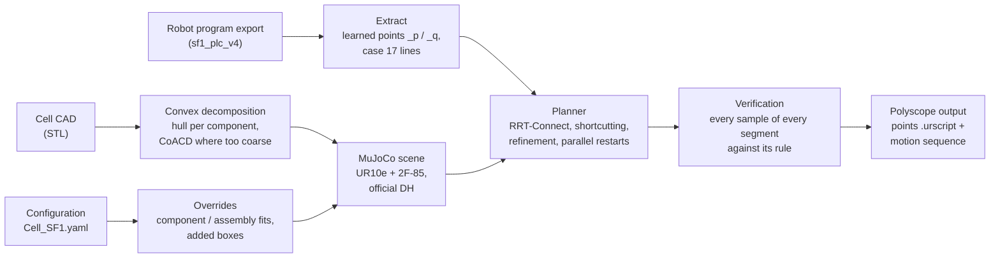

# UR PathGen SF1: Collision-Free Path Generation for a UR10e Collaborative Robot in the JIC Smart Factory Flexible Cell

Path generation and optimisation for a UR10e collaborative robot within the JIC Smart Factory
workspace for flexible small-batch production with high process variability.


<p align="center">
<picture>
  <source media="(prefers-color-scheme: dark)" srcset="Media/cell_overview_dark.png">
  
</picture>
</p>

> **Simulation passed ≠ safe on the robot.** Every path in this repository is a proposal verified
> in a simulation model. Run it on the real cell at reduced speed first.

## Contents

[About](#about) · [Results](#results) · [Figures](#figures) · [Architecture](#architecture) ·
[Repository layout](#repository-layout) · [Installation](#installation) · [Usage](#usage) ·
[Adapting to another cell](#adapting-to-another-cell) · [Limitations and safety](#limitations-and-safety) ·
[License](#license) · [Acknowledgement](#acknowledgement)

## About

This project was developed within internal research at JIC Smart Factory for **SF1 (Smart Factory 1)**,
a flexible robotic cell for low-volume, high-variability production. The cell is a machine-tending
cell: a Universal Robots UR10e with a Robotiq 2F-85 gripper loads and unloads a machine and turns
the part over in a regrasp station. Wherever "SF1" appears in file and variable names
(`Cell_SF1.yaml`, `SF1_Environment.stl`, `SF1_Rotation_17.urscript`), it refers to this cell.

**The problem.** The regrasp is a complex motion: the robot places the part into a holder, releases
it, moves around and re-grips it from the other side. The cell operator designed this motion by hand
on the teach pendant (case 17 of the robot program). The station operations are tight; the transfer
motions between them take most of the cycle (an estimated 21.06 of 23.37 s home → home).

**The approach.**

- A **MuJoCo digital twin** of the cell: the vendored UR10e and 2F-85 models, corrected to the
  official UR10e DH parameters, placed in the cell's CAD model.
- A **validated collision model**: the cell STL decomposed into convex pieces that contain the
  original surface, with recorded corrections where the CAD does not match the cell.
- A **joint-space planner** that re-plans only the three transfer segments (S1 home → drop, S2
  retreat → approach for the re-grip, S3 lift → home), keeps every taught station operation line for line, and
  minimises the estimated duration under explicit clearance margins.
- Several **strategies compared** on the same model: the taught program, the optimised transfers,
  an alternative wrist-3 representative at the re-grip, and alternative IK branches at the drop.

## Results

Case 17 of the program, home → home. All values are **simulation estimates** from
[`Data/Generated/variants/comparison.csv`](Data/Generated/variants/comparison.csv), written by
`Example/write_variants.py`. The estimated time assumes every move goes from rest to rest (r = 0);
the program's blends and the gripper time are not modelled.

| Variant | Status | Est. home → home [s] | vs taught | Via points | Joint travel Σ\|Δq\| [rad] | TCP path [m] | Max robot height [m] | Closest, S1–S3 [mm] | Least room above margin, S1–S3 [mm] |
|---|---|---:|---:|---:|---:|---:|---:|---:|---:|
| `taught` | the taught program (reference) | 23.37 | — | 5 | 45.440 | 7.062 | 2.322 | 8.4 | 3.4 (margin 5) |
| `b_optimised` | previous optimisation, superseded by c1 | 17.50 | −25.1 % | 4 | 38.642 | 6.604 | 2.263 | 10.1 | 0.4 (margin 30) |
| `c1` | **delivered** | 14.66 | −37.3 % | 4 | 35.395 | 6.446 | 2.263 | 10.1 | 0.4 (margin 30) |
| `c2` | proposal for re-teaching, not verified on the robot | 12.05 | −48.4 % | 2 | 23.462 | 3.237 | 1.818 | 10.1 | 5.1 (margin 5) |
| `c3` | proposal for re-teaching, not verified on the robot | 13.86 | −40.7 % | 4 | 24.792 | 3.372 | 1.780 | 10.1 | 5.1 (margin 5) |

- **The variants.** `b_optimised` re-plans S1–S3 on the taught points. `c1` (delivered, also in
  `Data/Generated/`) does the same with the re-grip's wrist 3 one turn lower (the same poses), so S3
  no longer turns wrist 3 by a full extra turn. `c2` and `c3` put the drop on another IK branch of
  the same taught poses (S− E− W− and S− E− W+); with these drop points the planned transfers stay
  low (highest robot point 1.818 and 1.780 m instead of 2.263 m). Their drop points are nominal-DH
  solutions and must be re-taught on the robot.
- **Clearance.** Closest is the smallest robot–environment distance in the three transfer segments.
  Least room is that distance minus the margin of the pair concerned: taught segments are judged by
  the taught rule, generated ones by the generated rule (20 mm to the environment, 30 mm to
  machine (a) outside the station zone, 5 mm inside the station zone). No variant has a sample that
  breaks its rule.
- **The station operations** (drop and re-grip) are the taught lines in every variant. Their
  closest pair, 5.5 mm between the gripper and the station bracket at the re-grip, is the same in
  all five and is the smallest distance of the whole cycle.

## Figures

Every image below is generated from the repository data by
[`Example/make_readme_figures.py`](Example/make_readme_figures.py); none is drawn by hand. All of
them show simulation estimates.

### The cell in MuJoCo

The environment in every render is the collision model the planner checks against: the convex
decomposition of the cell's CAD with the documented corrections (machine (a) moved 150 mm away from
the robot, the side cabinet 50 mm along −x, the station bracket and stub added as boxes), not the
original CAD. In the two renders below, the environment is grey, the station-zone pieces orange
and the robot is shown by its visual meshes.

<table>
  <tr>
    <th>The robot at home</th>
    <th>The regrasp station with the robot's collision geometry</th>
  </tr>
  <tr>
    <td><picture>
  <source media="(prefers-color-scheme: dark)" srcset="Media/robot_home_dark.png">
  
</picture></td>
    <td><picture>
  <source media="(prefers-color-scheme: dark)" srcset="Media/station_collision_dark.png">
  
</picture></td>
  </tr>
</table>

In the station close-up, machine (a) is drawn translucent so that the station-zone pieces (orange:
the configured bracket and stub boxes and the CAD pieces that meet the zone) and the robot's and
gripper's collision hulls (red) show. The robot is at `Waypoint_5`, the retreat after the drop.

### The collision model

<picture>
  <source media="(prefers-color-scheme: dark)" srcset="Media/collision_model_dark.png">
  
</picture>

This is everything the planner checks a path against, each group with the margin it must keep.
The robot and the gripper are their collision hulls (the gripper at the 50 mm holding opening).
Machine (a) and the side cabinet are moved from their CAD positions by the configured overrides.
The station holder and stub are added boxes, fitted to the taught program. The small translucent
box is the station zone: inside it, the zone pieces keep 5 mm instead of 20 mm.

### The paths

Each render shows one variant's TCP path home → home in its graph colour, with the taught path
drawn thin in blue for reference. The station-zone pieces are grey here, so that no path colour is
confused with them.

<picture>
  <source media="(prefers-color-scheme: dark)" srcset="Media/path_taught_dark.png">
  
</picture>

<table>
  <tr>
    <td><picture>
  <source media="(prefers-color-scheme: dark)" srcset="Media/path_b_optimised_dark.png">
  
</picture></td>
    <td><picture>
  <source media="(prefers-color-scheme: dark)" srcset="Media/path_c1_dark.png">
  
</picture></td>
  </tr>
  <tr>
    <td><picture>
  <source media="(prefers-color-scheme: dark)" srcset="Media/path_c2_dark.png">
  
</picture></td>
    <td><picture>
  <source media="(prefers-color-scheme: dark)" srcset="Media/path_c3_dark.png">
  
</picture></td>
  </tr>
</table>

The taught program, b_optimised and c1 all swing high above the station (highest robot point
2.322, 2.263 and 2.263 m). The c2 and c3 proposals put the drop on another IK branch and stay low
(1.818 and 1.780 m). They are proposals for re-teaching and are not verified on the robot.

### Comparison

<picture>
  <source media="(prefers-color-scheme: dark)" srcset="Media/cycle_time_dark.png">
  
</picture>

<picture>
  <source media="(prefers-color-scheme: dark)" srcset="Media/path_length_dark.png">
  
</picture>

<picture>
  <source media="(prefers-color-scheme: dark)" srcset="Media/max_height_dark.png">
  
</picture>

<picture>
  <source media="(prefers-color-scheme: dark)" srcset="Media/clearance_dark.png">
  
</picture>

<picture>
  <source media="(prefers-color-scheme: dark)" srcset="Media/joints_dark.png">
  
</picture>

The joint graph shows all five variants on the **estimated** timing: every move runs from rest to
rest (r = 0), so the program's blends are not modelled, and neither is the gripper time. The strip
above the joints gives each variant's sections, with the taught station operations hatched, and
where its sequence ends; c2 and c3 are dashed because they are proposals, not verified on the robot.

<picture>
  <source media="(prefers-color-scheme: dark)" srcset="Media/tcp_paths_dark.png">
  
</picture>

## Architecture



- **Taught vs generated rule.** Program lines are copied verbatim and judged by the taught rule.
  Only the transfer segments are generated: `movej` with joint targets, `r=0`, at most five via
  points, judged by the stricter generated rule. A segment that cannot meet it is an explicit
  failure, never a longer or colliding path.
- **Station zone.** The holder's geometry is fitted to the taught program, not measured. Inside a
  configured box around it the margin is 5 mm, always for taught lines and for a generated sample
  only within 50 mm of a fixed station point. Generated paths also stay no closer to a station box
  than their taught ends.
- **Conservative collision model.** Each STL component becomes its convex hull, or CoACD parts where
  the hull is too coarse, checked to contain the original surface. The 20 mm environment margin
  covers the kinematic error of nominal DH and the unmodelled cables.
- **Determinism.** Every planner budget is an iteration count and every run uses a recorded seed, so
  a plan depends only on its inputs. Planning in N worker processes gives the same output for any N.

## Repository layout

```text
CAD/              the cell STL (visual) and Collision/: the convex pieces and their manifest
Configuration/    Cell_SF1.yaml: base pose, tool and TCP, margins, overrides, workspace
Data/Programs/    verbatim extracts of the robot program and the simplified taught case 17
Data/Generated/   the delivered path (c1) and variants/: every variant and the comparison table
Example/          runnable scripts: viewers, planning, variants, figures, collision build
Media/            the README images (generated)
models/           vendored MuJoCo Menagerie UR10e and Robotiq 2F-85, pinned by hash
src/              Configuration, URScript, Kinematics, Collision, Scene, Planner
test/             pytest suite: the modules, the scripts and the installer
```

## Installation

macOS on Apple silicon (verified) or Ubuntu Linux (not verified), with Python 3.11:

```bash
brew install python@3.11                          # macOS
sudo apt install python3.11 python3.11-venv       # Ubuntu
./install.sh
```

`install.sh` creates `.venv`, installs the pinned `requirements.txt`, and verifies the vendored
models and the collision set against their recorded hashes. It is safe to re-run;
`./install.sh --detect-only` only reports what it would do.

On macOS the MuJoCo viewer needs `mjpython` (`.venv/bin/mjpython`); on Linux use
`.venv/bin/python`. Scripts that only compute or write files run with `.venv/bin/python` on both.

## Usage

**Show the robot at a learned position**, with its clearance:

```bash
.venv/bin/mjpython Example/demo_visualize_position.py --pos home_q
.venv/bin/python Example/demo_visualize_position.py --list
```

Viewer geom groups (number keys): `1` the cell STL, `2` the robot's visual meshes, `3` the collision
geometry. `--with-stl` also loads the cell STL, which the viewers leave out by default. The STL is
the original CAD without the collision model's corrections, so it does not match the geometry the
clearance is checked against; the viewers print a warning naming the corrections.

**Replay the variants** in the viewer, or write screenshots or a step list instead:

```bash
.venv/bin/mjpython Example/replay_rotation.py --path 3
.venv/bin/mjpython Example/replay_rotation.py --path 6 --speed 2
.venv/bin/python Example/replay_rotation.py --path 3 --headless
```

| `--path` | Path (case 17, home → home) |
|---|---|
| 1 | taught |
| 2 | b_optimised: previous optimisation |
| 3 | c1: delivered |
| 4 | c2: proposal, not verified on the robot |
| 5 | c3: proposal, not verified on the robot |
| 6 | all five in turn, with the strict comparison |

**Plan** the transfer segments S1–S3 of case 17 and write the delivered output to
`Data/Generated/`:

```bash
.venv/bin/python Example/plan_rotation.py --workers 8
```

The output is the same for every number of workers: 4–8 minutes with 8 on an M2 Pro, about 15 with 1.

**Regenerate** the variants with their comparison table, then the README figures:

```bash
.venv/bin/python Example/write_variants.py --workers 8        # about 15 minutes; --table-only re-measures
.venv/bin/python Example/make_readme_figures.py               # under a minute; --graphs-only skips the renders
```

**Rebuild the inputs** after the robot program or the cell STL changes:

```bash
.venv/bin/python Example/write_taught_programs.py
.venv/bin/python Example/build_collision.py                   # several minutes, runs CoACD
```

**Run the tests.** The everyday command leaves out the four slow tests and takes about 8 minutes;
run the full suite (about 14 minutes) before a commit:

```bash
.venv/bin/python -m pytest -m "not slow"
.venv/bin/python -m pytest
```

Measured on an M2 Pro, 2026-10-20. The slow tests are the parallel planning run (211 s), the
variant table re-measured from the files (67 s), the replay of every program segment (62 s) and the
README graphs regenerated byte for byte (4 s).

## Adapting to another cell

Replace the inputs in this order; each step builds on the one before.

1. **Cell geometry.** Put the cell's STL into `CAD/` (in the world frame the configuration uses)
   and run `Example/build_collision.py`. Read its report: pieces with a large excess (an open shell
   filled by its hull) need a component override or a configured box.
2. **Configuration** (`Configuration/Cell_SF1.yaml`): the robot base position and yaw, joint limits,
   the gripper coupling and mount yaw, the gripper openings, the margins, the station zone, the
   workspace box, the self-collision exclusions, and the component and assembly overrides and added
   boxes that correct the CAD. Every field states its unit and source.
3. **TCP.** `Tool.TCP_Offset` is copied from the robot's TCP setting, never derived from the points.
4. **Program export.** Put the extracts of the robot program into `Data/Programs/<program>/` (the
   learned `_p` / `_q` lines and the case's lines) and run `Example/write_taught_programs.py`.
5. **Positions and case.** The case, its station points, its taught via points and the gripper state
   per segment are constants of `Example/plan_rotation.py`.

Then re-validate before trusting any output:

- every learned point's DH FK · TCP against its `_p` (the scripts refuse a point outside the
  configured bound);
- the base yaw, by where the taught points land in the cell;
- the collision set's conservativeness and excess;
- the taught program replayed against the model, with every penetration explained;
- the margins against the new cell's kinematic error;
- the planned path on the real robot at reduced speed.

The test suite pins SF1's measured values (residuals, distances, durations). For a new cell they
are measured again, not copied.

## Limitations and safety

- **Simulation passed ≠ safe on the robot.** Every output is a proposal; run it on the real cell at
  reduced speed first.
- **Nominal DH, no calibration.** The kinematic error was measured at two learned poses only; at the
  generated via points it is unmeasured.
- **Estimated geometry.** The positions of machine (a) and the side cabinet are estimates, the
  regrasp station is fitted to the taught program, and the model is not valid inside machine (a).
- **Not modelled.** The program's blends, the gripper time, the carried part beyond the pad ends and
  the cables.
- **c1** turns the re-grip's wrist 3 one turn lower than taught; the robot's IK choice at those
  lines is confirmed only by the first run. **c2 and c3** are proposals for re-teaching, never run.
- The joint limits are the hardware range; the cell's Polyscope safety limits may be tighter.

## License

MIT License, Copyright (c) 2026 JIC Smart Factory. See [LICENSE](LICENSE).

The vendored robot and gripper models in `models/` keep their own licences (MuJoCo Menagerie); see
the `LICENSE` file in each model folder.

## Acknowledgement

Developed within internal research at JIC Smart Factory.
